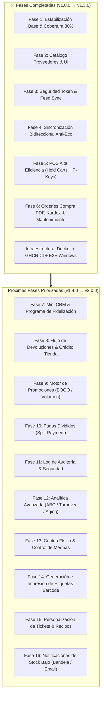

# 🗺️ Roadmap Integral del Proyecto SNIG (Sistema Nacional de Inventario General)

> [!NOTE]
> Este documento consolida todo el trabajo realizado hasta la fecha (**Fases 1 a 6 — Versión 1.3.0**) y la hoja de ruta hacia el futuro (**Fases 7 a 16**), diseñada a partir del estudio de campo de sistemas POS/Inventario modernos (Square, Shopify POS, Lightspeed, Odoo).

---

## 1. Visión General del Proyecto y Progreso



---

## 2. Lo que HEMOS HECHO (Fases Completadas)

### 📌 Fase 1: Estabilización, Desacoplamiento y Cobertura (v1.2.0)
- ✅ Eliminación de campos farmacéuticos y normalización genérica de productos.
- ✅ Autenticación desacoplada con flag (`AUTENTICACION_HABILITADA = False`).
- ✅ Cobro con tarjeta desactivado limpiamente (`PAGO_TARJETA_HABILITADO = False`).
- ✅ Unificación de terminología visual como **Barcode (GTIN)**.
- ✅ Suite de pruebas automatizadas elevadas a **cobertura ≥ 80%**.

### 📌 Fase 2: Catálogo de Proveedores y Panel de Escritorio
- ✅ Modelo `Proveedor` con relación muchos a muchos (`productos_proveedores`).
- ✅ Pestaña dedicada en PyQt5 para altas, edición y asignación de productos a proveedores.
- ✅ Columna de proveedor en la tabla principal de inventario.
- ✅ Panel lateral de navegación con accesos rápidos.

### 📌 Fase 3: Seguridad de Sincronización y Feed Incremental
- ✅ Feed REST de cambios (`/api/sync/cursor`, `/api/sync/changes`).
- ✅ Autenticación estricta Bearer Token con `SYNC_API_TOKEN` e inmunidad a ataques de temporización (`hmac.compare_digest`).
- ✅ Modelos `SyncState` y `SyncChange` para registro transaccional de eventos.

### 📌 Fase 4: Sincronización Bidireccional Distribuida
- ✅ Migración de esquema a **UUID v4** en todas las entidades (`Producto`, `Presentacion`, `Venta`, etc.).
- ✅ Soporte para bajas lógicas (*tombstones*) con `eliminado` y `fecha_eliminacion`.
- ✅ Context manager anti-eco `sin_disparo_sync()` para evitar bucles de actualización.
- ✅ Cliente de sincronización `ClienteSincronizacion` con cursor secuencial, procesamiento por lotes (*batch*) y resolución híbrida de conflictos (LWW para metadatos, ledger inmutable para transacciones).

### 📌 Fase 5: POS de Alta Eficiencia (Flujo Rápido de Caja)
- ✅ **Carritos en espera múltiples (*Hold Carts*)**: pausar ticket actual, atender a otro cliente y reanudar o descartar cuando sea necesario (`pausar_carrito()`, `reanudar_carrito()`).
- ✅ **Atajos de teclado F-Keys** en la interfaz PyQt5:
  - `F1`: Búsqueda / enfoque en código de barras.
  - `F2`: Cobro directo.
  - `F3`: Limpiar carrito.
  - `F4`: Pausar carrito actual.
  - `F5`: Ver carritos en espera.
- ✅ **Autocompletado predictivo inteligente (`QCompleter`)** en el campo Barcode.

### 📌 Fase 6: Compras, Trazabilidad y Mantenimiento
- ✅ Generador formal de **Órdenes de Compra en PDF** (`generar_orden_compra_pdf()`) con ReportLab, datos del proveedor, detalle de ítems y totales.
- ✅ **Kardex cronológico** de movimientos por producto (`obtener_kardex_producto()`).
- ✅ Mantenimiento automatizado: rotación y depuración de backups antiguos (`rotar_backups_antiguos()`, retención de 15 días).
- ✅ Optimización de base de datos (`optimizar_base_de_datos()` con `VACUUM`, `ANALYZE` y `PRAGMA optimize`).

### 📌 Infraestructura, Despliegue y Automatización E2E
- ✅ Contenedorización con `Dockerfile`, `docker-compose.yml` y dependencias de servidor (`requirements-server.txt`).
- ✅ CI en GitHub Actions para compilar y publicar imágenes OCI en **GitHub Packages (GHCR)**.
- ✅ Framework de pruebas automatizadas de escritorio nativas en Windows (`windows-desktop-e2e`) con `pywinauto` y Windows UI Automation (UIA).
- ✅ **187 pruebas automatizadas pasando al 100%** sin fallos.

---

## 3. Lo que QUEREMOS HACER (Roadmap Futuro Priorizado)

```mermaid
gantt
    title Cronograma de Implementación Futura (Fases 7 a 16)
    dateFormat  YYYY-MM-DD
    section Alta Prioridad (Comercial / POS)
    Fase 7: Mini CRM & Puntos de Fidelidad       :active, f7, 2026-11-15, 5d
    Fase 8: Devoluciones, Reembolsos & Crédito   :f8, after f7, 4d
    Fase 9: Motor de Promociones (2x1, Volumen)  :f9, after f8, 5d
    Fase 10: Pagos Divididos (Split Payment)     :f10, after f9, 3d
    section Auditoría y Analítica
    Fase 11: Registro de Auditoría (Audit Log)   :f11, after f10, 3d
    Fase 12: KPIs Avanzados (ABC, Turnover)      :f12, after f11, 4d
    section Operaciones de Tienda
    Fase 13: Conteo Físico & Mermas              :f13, after f12, 4d
    Fase 14: Generador de Etiquetas Barcode      :f14, after f13, 3d
    Fase 15: Personalización de Tickets          :f15, after f14, 2d
    Fase 16: Notificaciones Automáticas Stock   :f16, after f15, 3d
```

### Detalle de cada fase futura:

| Fase | Nombre | Objetivo principal | Nuevos Modelos / Componentes | Complejidad |
| :---: | :--- | :--- | :--- | :---: |
| **7** | **Mini CRM & Fidelización** | Registrar clientes, asociar ventas a clientes, acumular puntos y canjearlos como descuentos en caja. | `Cliente`, `ProgramaFidelidad` | Media |
| **8** | **Devoluciones & Reembolsos** | Buscar tickets anteriores, seleccionar ítems a devolver, reingresar stock automáticamente y emitir nota de crédito o dinero. | `Devolucion`, `DevolucionItem` | Media |
| **9** | **Motor de Promociones** | Reglas automáticas en POS: 2x1 (BOGO), descuentos porcentuales temporales, combos y precios por volumen. | `Promocion`, `promociones_productos` | Alta |
| **10** | **Pagos Divididos (Split Payment)** | Permitir liquidar una sola venta con múltiples formas de pago (ej: parte en efectivo + parte transferencia + crédito). | `PagoVenta` (1:N con `Venta`) | Baja |
| **11** | **Log de Auditoría & Seguridad** | Trazabilidad inmutable de quién cambió un precio, eliminó un producto o realizó aperturas de caja. | `AuditLog` | Baja |
| **12** | **KPIs Avanzados en Dashboard** | Incorporar al dashboard Streamlit análisis ABC (Pareto 80/20), rotación de inventario (*turnover*), tasa de venta (*sell-through*) y reporte de mercancía estancada (*dead stock*). | Cálculos analíticos en `reporting/` | Media |
| **13** | **Conteo Físico de Inventario** | Crear sesiones de inventario físico, escanear existencias reales, calcular descuadres y generar ajustes masivos de merma. | `SesionConteo`, `LineaConteo` | Media |
| **14** | **Generación de Etiquetas Barcode** | Generar e imprimir hojas PDF con etiquetas de código de barras para estanterías y productos sin empaque. | Módulo PDF en `reporting/` | Baja |
| **15** | **Personalización de Recibos** | Permitir configurar logo del negocio, dirección, teléfono, pie de página con políticas de garantía y QR. | Configuración en `settings.py` + PDF | Baja |
| **16** | **Notificaciones Automáticas** | Alertas en segundo plano en la bandeja de Windows y envío opcional de reportes de stock bajo por correo SMTP. | Hilo background + `QSystemTrayIcon` | Baja |

---

## 4. Evolución de la Cobertura y Métricas de Calidad

| Hito | Tests Totales | Cobertura | Estado |
| :--- | :---: | :---: | :---: |
| **Inicio del proyecto** | ~50 | < 60% | Legado |
| **v1.2.0 (Fases 1 a 3)** | 166 | 80.2% | Completado |
| **v1.3.0 (Fases 4 a 6)** | **187** | **81.5%** | **Actual (Completado)** |
| *Proyección Fases 7 a 10* | ~215 | ≥ 82% | Próximo objetivo |
| *Proyección Fases 11 a 16* | ~238 | ≥ 83% | Objetivo v2.0 |

---

## 5. Próximo Paso Recomendado

Iniciar con la **Fase 7 (Mini CRM y Programa de Fidelización)**:
1. Crear el modelo `Cliente` y su relación con `Venta`.
2. Implementar la acumulación de puntos por compras.
3. Crear endpoints REST y la pestaña en la interfaz de escritorio.
4. Escribir pruebas unitarias siguiendo metodología TDD estricta.
